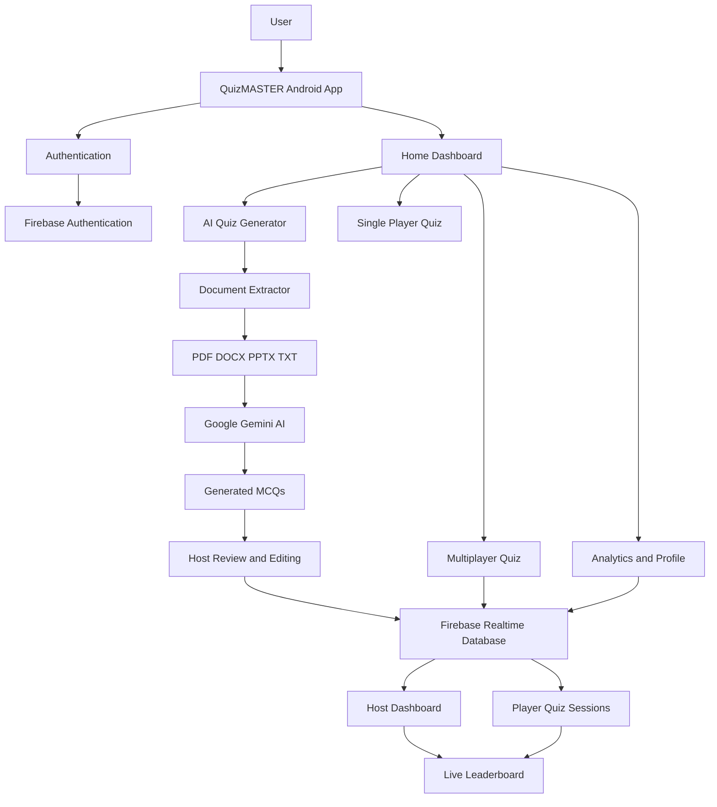

# 🎓 QuizMASTER – AI-Powered & Live Multiplayer Android Quiz App

**QuizMASTER** is a feature-rich native Android quiz application developed using **Kotlin** that transforms the traditional quiz experience into an interactive, intelligent, and collaborative learning platform.

The application combines AI-powered quiz generation, real-time multiplayer competitions, single-player practice sessions, and performance analytics in one platform.

Users can generate quizzes automatically from their study materials, participate in live group quizzes with friends, practice programming and technical subjects, and track their learning progress.

The application uses **Google Gemini AI** to generate multiple-choice questions from uploaded documents and **Firebase Realtime Database** to synchronize multiplayer quiz sessions.

---

## 📌 Table of Contents

1. [Project Overview](#-project-overview)
2. [Problem Statement](#-problem-statement)
3. [Project Objectives](#-project-objectives)
4. [Key Features](#-key-features)
5. [Application Modules](#-application-modules)
6. [Technology Stack](#-technology-stack)
7. [System Architecture](#-system-architecture)
8. [Project Structure](#-project-structure)
9. [Application Workflow](#-application-workflow)
10. [Firebase Database Structure](#-firebase-database-structure)
11. [AI Quiz Generation Process](#-ai-quiz-generation-process)
12. [Real-Time Multiplayer Mechanism](#-real-time-multiplayer-mechanism)
13. [Installation and Setup](#-installation-and-setup)
14. [Firebase Configuration](#-firebase-configuration)
15. [Gemini AI Configuration](#-gemini-ai-configuration)
16. [Permissions](#-permissions)
17. [Libraries and Dependencies](#-libraries-and-dependencies)
18. [Testing](#-testing)
19. [Advantages](#-advantages)
20. [Future Enhancements](#-future-enhancements)
21. [Limitations](#-limitations)
22. [Contributing](#-contributing)
23. [License](#-license)

---

## 🚀 Project Overview

QuizMASTER is an Android-based educational application designed to make learning more engaging through interactive quizzes and AI-assisted question generation.

Unlike traditional quiz applications that depend entirely on predefined questions, QuizMASTER allows users to upload their own educational documents and convert them into customized multiple-choice quizzes.

The application supports four major document formats:

- PDF (.pdf)
- Microsoft Word (.docx)
- Microsoft PowerPoint (.pptx)
- Text Files (.txt)

After extracting text from the uploaded document, the application sends the content to Google's Gemini AI model, which generates relevant multiple-choice questions based on the provided study material.

Users can also host multiplayer quiz sessions, invite participants using a unique room code, monitor their progress, and view final rankings.

QuizMASTER provides three primary learning experiences:

1. **AI-Powered Learning:** Generate quizzes from personal study documents.
2. **Live Multiplayer:** Compete with friends in real-time quiz sessions.
3. **Individual Practice:** Improve knowledge through subject-based quizzes.

---

## ❗ Problem Statement

Traditional learning methods often involve reading lengthy study materials and manually preparing questions for practice.

Students also face difficulties finding interactive platforms that allow them to:

- Convert their own study materials into practice questions.
- Conduct quizzes with friends in real time.
- Monitor individual and group performance.
- Practice technical subjects through interactive quizzes.
- Evaluate their learning progress effectively.

QuizMASTER addresses these problems by integrating artificial intelligence, document processing, cloud-based synchronization, and interactive quiz functionality into a single Android application.

---

## 🎯 Project Objectives

The main objectives of QuizMASTER are:

- To develop an interactive Android quiz application using Kotlin.
- To integrate Google Gemini AI for automatic MCQ generation.
- To support PDF, DOCX, PPTX, and TXT document uploads.
- To implement real-time multiplayer quizzes using Firebase Realtime Database.
- To provide customized quiz settings, including question count and difficulty.
- To implement interactive lifelines for single-player quizzes.
- To provide real-time score tracking and leaderboard functionality.
- To maintain user quiz history and performance statistics.
- To create an engaging and user-friendly learning environment.

---

## 🌟 Key Features

### 1. 🤖 AI-Powered Document Quiz Generator

QuizMASTER uses Google Gemini AI to transform educational documents into interactive quizzes.

**Supported Document Formats**

| Format | Extension | Processing Library |
|---|---|---|
| PDF | .pdf | PDFBox-Android |
| Word | .docx | Apache POI |
| PowerPoint | .pptx | Apache POI |
| Text | .txt | Native File Processing |

**Features:**

- Upload educational documents directly from the device.
- Extract text automatically from supported file formats.
- Generate multiple-choice questions using Gemini AI.
- Customize the number of questions from 5–30 or use a custom count.
- Select difficulty levels:
  - Easy
  - Medium
  - Hard
- Generate questions with four answer options.
- Identify the correct answer for every question.
- Review generated questions before publishing.
- Edit individual questions and answer options.
- Regenerate questions when necessary.
- Remove unwanted questions.
- Publish approved questions to a multiplayer quiz room.

### 2. ⚡ Live Multiplayer Group Quizzes

QuizMASTER provides an interactive multiplayer experience where multiple users can participate in the same quiz session.

**Host Features:**

- Create a multiplayer quiz room.
- Generate a unique room code, such as `QZ1234`.
- Upload study material and generate AI questions.
- Review and approve generated questions.
- Publish questions to the room.
- Monitor participant progress.
- Track completed and ongoing quizzes.
- Control the quiz session.

**Player Features:**

- Join a room using a unique room code.
- Participate in the same quiz session as other players.
- Answer questions in an interactive interface.
- Submit answers and track quiz progress.
- View final scores and rankings.

**Real-Time Synchronization:**

Firebase Realtime Database is used to synchronize room information, quiz questions, participant states, and results across connected devices.

**Synchronized Shuffling:**

A fixed-seed shuffling mechanism ensures that all participants receive the same shuffled question and option order for a session while making the quiz presentation less predictable.

**Live Results and Leaderboard:**

After quiz completion, participants are ranked according to their scores.

The leaderboard displays player rankings and quiz performance.

### 3. 🧠 Single-Player Practice Mode

The single-player mode allows users to practice independently using predefined quiz categories.

**Available Categories:**

- Python
- Java
- Android Development
- DBMS
- SQL
- General Knowledge

**Interactive Lifelines:**

| Lifeline | Function |
|---|---|
| 50:50 | Removes two incorrect answer options. |
| Timer Freeze | Temporarily pauses the countdown timer. |
| Skip Question | Moves a difficult question to the skipped-question queue. |

**Additional Features:**

- Interactive MCQ interface.
- Countdown timer for each question.
- Automatic answer evaluation.
- Score calculation.
- Question navigation.
- Correct and incorrect answer feedback.
- Sound effects using Android SoundPool.
- Phone vibration when time expires.

### 4. 📊 Performance Analytics and Dashboard

The application provides performance tracking features to help users understand their learning progress.

**Dashboard Statistics:**

- Total quizzes attempted.
- Average score percentage.
- Current quiz streak.
- Recent quiz performance.
- Category-wise quiz scores.
- Individual quiz history.

Users can review previous quiz attempts and evaluate their improvement over time.

### 5. 🔐 Authentication and User Profile

Firebase Authentication provides user registration and login functionality.

**Features:**

- User registration.
- Secure sign-in.
- Authentication-based access.
- User profile management.
- Personalized quiz statistics.
- Quiz history tracking.

---

## 📱 Application Modules

QuizMASTER is divided into the following functional modules:

| Module | Description |
|---|---|
| Authentication Module | Handles user registration and login. |
| Home Dashboard | Provides navigation to application features. |
| AI Quiz Generator | Extracts document content and generates MCQs using Gemini AI. |
| Document Upload | Allows users to select supported study files. |
| Host Lobby | Creates multiplayer rooms and manages quiz setup. |
| Player Lobby | Allows participants to join rooms. |
| Host Review | Allows editing and approval of AI-generated questions. |
| Host Dashboard | Displays real-time participant progress. |
| Single-Player Quiz | Provides individual quiz practice. |
| Multiplayer Quiz | Manages synchronized group quiz sessions. |
| Result Module | Displays quiz completion details and scores. |
| Group Leaderboard | Displays multiplayer rankings. |
| History Module | Stores and displays previous quiz attempts. |
| Profile Module | Displays user information and performance statistics. |

---

## 🛠️ Technology Stack

QuizMASTER uses modern Android development technologies and cloud services.

### Programming Language

- **Kotlin:** Primary programming language used for application development.

### Android Development

- Android Studio
- Android SDK
- XML Layouts
- Material Design 3
- ConstraintLayout
- RecyclerView
- CardView
- BottomNavigationView

### Backend and Database

- Firebase Realtime Database
- Firebase Authentication

### Artificial Intelligence

- Google Gemini AI
- Firebase AI Developer SDK

### Document Processing

- PDFBox-Android
- Apache POI
- DOCX and PPTX document extraction
- TXT file processing

### Concurrency and Background Processing

- Kotlin Coroutines
- Dispatchers.IO
- lifecycleScope

### Audio and Haptic Feedback

- Android SoundPool API
- VibratorManager

### Development Environment

- Android Studio
- Gradle Kotlin DSL
- Git
- GitHub

### Platform Requirements

| Requirement | Specification |
|---|---|
| Application Type | Native Android Application |
| Language | Kotlin |
| Minimum Android Version | Android 8.0 Oreo |
| Minimum SDK | API 26 |
| Target SDK | API 37 |
| UI Framework | XML and Material Design 3 |
| Backend | Firebase |
| AI Engine | Google Gemini |

---

## 🏗️ System Architecture

The application follows a modular architecture in which different components handle document extraction, AI processing, database operations, user interaction, and multiplayer synchronization.

### Architecture Components

**1. Presentation Layer**

Responsible for displaying application screens and handling user interactions.

Includes:
- MainActivity
- LoginActivity
- RegisterActivity
- UploadActivity
- LobbyActivity
- QuizActivity
- ResultActivity
- ProfileActivity

**2. Business Logic Layer**

Responsible for processing application operations.

Includes:
- AIQuestionGenerator
- DocumentExtractor
- QuestionProvider
- ShuffleUtility
- RoomManager

**3. AI Processing Layer**

Google Gemini AI processes extracted study material and generates MCQs.

**4. Backend Layer**

Firebase services manage authentication, multiplayer room data, participant states, and real-time synchronization.

**5. Local Android Layer**

Android APIs handle document selection, audio feedback, vibration, timers, and UI interactions.

### System Architecture Diagram



---

## 📁 Project Structure

The project is organized into separate Kotlin classes and Android resource directories to maintain modularity and simplify maintenance.

```text
QuizMASTER/
│
├── app/
│   │
│   ├── src/
│   │   └── main/
│   │       │
│   │       ├── java/com/example/quizmaster/
│   │       │   │
│   │       │   ├── AIQuestionGenerator.kt
│   │       │   ├── DocumentExtractor.kt
│   │       │   ├── RoomManager.kt
│   │       │   ├── RoomModels.kt
│   │       │   ├── Question.kt
│   │       │   ├── QuestionProvider.kt
│   │       │   ├── ShuffleUtility.kt
│   │       │   │
│   │       │   ├── MainActivity.kt
│   │       │   ├── UploadActivity.kt
│   │       │   ├── LobbyActivity.kt
│   │       │   ├── HostReviewActivity.kt
│   │       │   ├── HostDashboardActivity.kt
│   │       │   │
│   │       │   ├── QuizActivity.kt
│   │       │   ├── ResultActivity.kt
│   │       │   ├── GroupResultActivity.kt
│   │       │   ├── CategoryActivity.kt
│   │       │   │
│   │       │   ├── HistoryActivity.kt
│   │       │   ├── ProfileActivity.kt
│   │       │   ├── LoginActivity.kt
│   │       │   └── RegisterActivity.kt
│   │       │
│   │       ├── res/
│   │       │   ├── layout/
│   │       │   ├── drawable/
│   │       │   ├── mipmap/
│   │       │   └── values/
│   │       │
│   │       ├── AndroidManifest.xml
│   │       └── google-services.json
│   │
│   └── build.gradle.kts
│
├── build.gradle.kts
├── settings.gradle.kts
├── gradle.properties
└── README.md
```

---

## 🔄 Application Workflow

### Step 1: User Authentication

The user registers or logs into the application using Firebase Authentication.

### Step 2: Home Dashboard

After successful authentication, the user reaches the home dashboard, where different quiz modes are available.

### Step 3: Select Quiz Mode

The user can choose between:

- AI Document Quiz Generation
- Single-Player Practice
- Live Multiplayer Quiz

### Step 4: AI Document Processing

For document-based quizzes:

1. Select a document from the device.
2. Extract text using the appropriate document parser.
3. Configure question count.
4. Select the difficulty level.
5. Send the extracted content to Gemini AI.
6. Receive generated MCQs.
7. Review and edit the questions.

### Step 5: Start Quiz

The user can start an individual quiz or publish approved questions to a multiplayer room.

### Step 6: Quiz Participation

Participants answer questions through an interactive quiz interface.

The application evaluates responses and updates scores and progress.

### Step 7: Results and Analytics

After quiz completion, the application displays:

- Total score.
- Correct answers.
- Incorrect answers.
- Performance percentage.
- Player ranking in multiplayer sessions.

---

## 🔥 Firebase Database Structure

Firebase Realtime Database is used to maintain live multiplayer quiz information.

An illustrative database structure is:

```json
{
  "rooms": {
    "QZ1234": {
      "hostId": "host_uid",
      "roomStatus": "WAITING",
      "questions": {
        "0": {
          "question": "What is Kotlin?",
          "options": [
            "Programming Language",
            "Database",
            "Operating System",
            "Browser"
          ],
          "correctAnswer": 0
        }
      },
      "players": {
        "player_uid": {
          "displayName": "Player 1",
          "score": 10,
          "progress": 1,
          "status": "COMPLETED"
        }
      }
    }
  }
}
```

*Note: This is an illustrative representation of the database structure. Actual field names and nesting should match the implementation in RoomModels.kt and RoomManager.kt.*

### Firebase Services

| Firebase Service | Purpose |
|---|---|
| Firebase Authentication | User login and registration. |
| Firebase Realtime Database | Room creation and live synchronization. |
| Database Listeners | Receive real-time room and player updates. |

---

## 🤖 AI Quiz Generation Process

Google Gemini AI is integrated to generate questions automatically from uploaded educational documents.

### Processing Steps

1. The user uploads a study document.
2. DocumentExtractor identifies the file type.
3. PDFBox-Android or Apache POI extracts the document text.
4. Extracted content is passed to AIQuestionGenerator.
5. Gemini AI analyzes the provided content.
6. The AI generates multiple-choice questions.
7. Generated responses are parsed into Question objects.
8. The host reviews and edits the questions.
9. Approved questions are used in the quiz session.

### AI-Generated Question Format

Example:

```json
{
  "question": "Which language is primarily used for Android development in QuizMASTER?",
  "options": [
    "Python",
    "Kotlin",
    "C++",
    "PHP"
  ],
  "correctAnswer": 1,
  "difficulty": "Easy"
}
```

The application uses structured question data to display questions and evaluate answers.

**Important:** AI-generated answers should be reviewed before use because generated content may occasionally contain inaccurate information.

---

## ⚡ Real-Time Multiplayer Mechanism

The multiplayer functionality is powered by Firebase Realtime Database.

### Room Creation

- The host creates a new room.
- A unique room code is generated.
- Room information is stored in Firebase.
- Other users join using the room code.

### Question Publishing

- The host uploads study material.
- Gemini generates quiz questions.
- The host reviews and approves the questions.
- Approved questions are published to Firebase.

### Player Synchronization

- Players receive room updates through database listeners.
- Quiz information is synchronized across connected devices.
- Participant progress is updated in real time.
- The host monitors participant status.

### Leaderboard Generation

After the quiz ends:

- Participant scores are collected.
- Scores are compared.
- Players are ranked.
- Final leaderboard information is displayed.

---

## 💻 Installation and Setup

Follow these steps to run QuizMASTER locally.

### Prerequisites

Before starting, make sure you have:

- Android Studio installed.
- Android SDK installed.
- JDK compatible with the project's Gradle configuration.
- Kotlin support enabled.
- A Google account for Firebase and Gemini configuration.
- An Android device or emulator.
- Internet connectivity for Firebase and AI functionality.

### 1. Clone the Repository

Open your terminal and execute:

```bash
git clone YOUR_GITHUB_REPOSITORY_URL
```

Navigate to the project directory:

```bash
cd QuizMASTER
```

### 2. Open the Project

1. Open Android Studio.
2. Select **Open Project**.
3. Navigate to the QuizMASTER directory.
4. Wait for Gradle synchronization.
5. Resolve any dependency or SDK configuration issues.

### 3. Configure Firebase

Create a Firebase project and register your Android application.

Download the `google-services.json` file and place it inside:

```text
QuizMASTER/app/google-services.json
```

### 4. Configure Gemini AI

Enable the Firebase AI service and configure the Gemini model according to the Firebase AI Developer SDK setup.

Ensure that the application has the required configuration and access to the AI service.

### 5. Run the Application

1. Connect an Android device or launch an emulator.
2. Enable USB debugging if using a physical device.
3. Select the QuizMASTER run configuration.
4. Click the Run button in Android Studio.
5. Register or log in to start using the application.

---

## 🔥 Firebase Configuration

To configure Firebase:

1. Visit the [Firebase Console](https://console.firebase.google.com/).
2. Create a new Firebase project.
3. Add an Android application.
4. Enter the correct application package name.
5. Download `google-services.json`.
6. Add the file to the app directory.
7. Enable Firebase Authentication.
8. Enable the Realtime Database.
9. Configure the required database security rules.
10. Synchronize the project with Gradle.

**Security Note:** Never expose Firebase service account credentials or unrestricted database access. Configure production database rules to ensure that only authorized users can read or modify appropriate data.

---

## 🤖 Gemini AI Configuration

QuizMASTER uses Google's Gemini AI through the Firebase AI Developer SDK.

### Configuration Steps

1. Open the Firebase Console.
2. Select your Firebase project.
3. Configure Firebase AI.
4. Enable the required Gemini model.
5. Add the Firebase AI SDK dependency.
6. Initialize the AI functionality in the application.
7. Configure the question generation prompt.
8. Test AI question generation with a sample document.

The application uses Gemini AI to generate questions based on the uploaded study material and selected difficulty.

**Security Note:** Avoid hardcoding sensitive API keys in source code or committing secrets to GitHub. Use the recommended Firebase AI configuration and appropriate application security practices.

---

## 🔐 Permissions

The application may require the following Android permissions depending on the implemented features:

| Permission | Purpose |
|---|---|
| INTERNET | Firebase and Gemini AI communication. |
| VIBRATE | Haptic feedback during quiz events. |
| ACCESS_NETWORK_STATE | Check network connectivity, if implemented. |

Document access should use Android's Storage Access Framework where possible, allowing users to select files without requesting broad storage permissions.

---

## 📦 Libraries and Dependencies

The major libraries and APIs used in the project include:

| Library / API | Purpose |
|---|---|
| Kotlin | Application programming language. |
| Firebase Authentication | User authentication. |
| Firebase Realtime Database | Multiplayer data synchronization. |
| Firebase AI Developer SDK | Gemini AI integration. |
| PDFBox-Android | PDF document extraction. |
| Apache POI | DOCX and PPTX document extraction. |
| Kotlin Coroutines | Asynchronous processing. |
| Material Design 3 | Modern Android UI. |
| ConstraintLayout | Responsive screen layouts. |
| RecyclerView | Dynamic lists and question displays. |
| CardView | Card-based UI components. |
| SoundPool | Quiz sound effects. |
| VibratorManager | Haptic feedback. |

Refer to the module-level `build.gradle.kts` file for the exact dependency versions.

---

## 🧪 Testing

The following test scenarios can be used to evaluate the application's functionality.

| Test Case | Expected Result |
|---|---|
| User Registration | New users should be able to register. |
| User Login | Registered users should be able to sign in. |
| PDF Upload | PDF content should be extracted. |
| DOCX Upload | Word document content should be extracted. |
| PPTX Upload | Presentation content should be extracted. |
| TXT Upload | Text content should be extracted. |
| AI Question Generation | Gemini should generate MCQs from extracted content. |
| Question Editing | Host should be able to edit generated questions. |
| Room Creation | A unique room code should be generated. |
| Room Joining | Players should be able to join using the room code. |
| Live Synchronization | Room and player updates should be reflected across devices. |
| Single-Player Quiz | Answers and scores should be evaluated correctly. |
| Lifelines | Available lifelines should work correctly. |
| Leaderboard | Players should be ranked based on their scores. |
| Quiz History | Previous quiz records should be accessible. |

---

## ✅ Advantages

- AI-powered automatic question generation.
- Supports multiple educational document formats.
- Reduces manual quiz preparation.
- Supports individual and multiplayer learning.
- Provides real-time synchronization.
- Offers customizable question difficulty.
- Includes interactive lifelines.
- Provides performance analytics.
- Uses Firebase for cloud-based services.
- Developed using native Android technologies.

---

## 🔮 Future Enhancements

The application can be improved further with the following features:

1. **Additional Languages:** Support quizzes in multiple regional and international languages.
2. **AI Explanation System:** Provide explanations for correct and incorrect answers.
3. **Advanced Analytics:** Add detailed performance graphs and subject-wise insights.
4. **Global Leaderboards:** Introduce rankings across all registered users.
5. **Quiz Scheduling:** Allow hosts to schedule multiplayer quiz sessions.
6. **Offline Practice:** Enable users to practice previously downloaded quizzes without internet access.
7. **Question Bookmarks:** Allow users to save important questions.
8. **Achievement System:** Introduce badges, rewards, and learning milestones.
9. **Enhanced Security:** Implement stronger room access validation and answer submission controls.
10. **Adaptive Learning:** Generate questions based on individual performance and learning levels.

---

